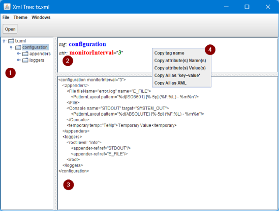

## Xml Tree
### _Легкий кросплатформний переглядач структури XML-файлів_

[](https://www.java.com/) [](https://uk.wikipedia.org/wiki/Swing_(Java)) [](https://maven.apache.org/) [](#)

🇬🇧 [English version](README.md)

### 💡 Призначення
Легкий мультиплатформний GUI-застосунок лише на стандартній Java для зручного перегляду структури XML-файлів: файл показується деревом, назва, значення й атрибути вибраного тега підсвічуються кольором, а його вміст показується відформатованим (AKA Fine Print) і готовим до копіювання.

### 📃 Можливості
- [Головне вікно](#MainWin) показує структуру XML-файлу деревом і автоматично відформатований XML вибраного тега
- [Копіювання](#Copying) назв і значень тегів та атрибутів у кількох форматах
- [Нечіткий пошук](#Search) у назвах / значеннях тегів і назвах / значеннях атрибутів
- [Кілька вікон](#AppMenu) – кожен файл відкривається у власному незалежному вікні
- [Теми](#AppMenu) – перемикання стандартних Swing Look and Feel для всіх відкритих вікон
- [Відкриття файлу з командного рядка](#Launch)

### ⭐ Переваги
- **Легкий** – jar-файл менше 100Kb без жодних сторонніх бібліотек, швидкий старт.
- **Мультиплатформний** – працює всюди, де є Java 8 або новіша (Linux, Windows, macOS).
- **Безпечний для неперевірених файлів** – зовнішні DTD і зовнішні сутності ніколи не завантажуються, тож відкриття файлу не робить мережевих запитів і не читає інших локальних файлів.
- **Враховує кодування** – кодування береться з XML-декларації або BOM (наприклад, файли у `windows-1251` показуються коректно).
- **Простий у користуванні** – стандартні меню, гарячі клавіші та контекстне меню.

### 📱 Скріншоти
<table>
  <tr>
    <td align="center"></td>
  </tr>
  <tr>
    <td align="center"><i>Головне вікно</i></td>
  </tr>
</table>

### 📌 Використання

#### Запуск<a id='Launch' />
**_Запустіть jar-файл за допомогою JRE 8 або новішої, за бажанням передавши XML-файл для показу._**
- Linux: `launch.sh [файл]` або `java -jar xmltree.jar [файл]`
- Windows: `launch.cmd [файл]` або `javaw -jar xmltree.jar [файл]`
- Без параметра (або якщо файлу не існує) відкривається стандартний діалог вибору файлу в поточному каталозі; показуються лише файли `*.xml` і `*.xsd`.
- Якщо файл не є коректним XML, показується повідомлення про помилку, а вікно залишається порожнім – натисніть **Open**, щоб вибрати інший файл.

#### Головне вікно<a id='MainWin' />
**_Дерево тегів ліворуч, деталі вибраного тега праворуч (див. скріншот)._**
1. дерево XML-файлу з поточним вибраним тегом
2. панель тега та атрибутів зі значеннями, підсвіченими кольором: назва тега (синій), назви атрибутів (червоний), значення (зелений)
3. відформатований XML вибраного тега
4. контекстне меню панелі тега та атрибутів (див. [Копіювання](#Copying))
5. панель пошуку (див. [Пошук](#Search))

#### Копіювання<a id='Copying' />
**_Правий клік на панелі тега та атрибутів відкриває контекстне меню; результат потрапляє в системний буфер обміну._**
- **Copy tag name** – назва тега (синій)
- **Copy attribute(s) Name(s)** – **усі** назви атрибутів поточного тега (червоний), по одній на рядок
- **Copy attribute(s) Value(s)** – **усі** значення атрибутів поточного тега (зелений), по одному на рядок
- **Copy All as 'key=value'** – тег і **всі** його атрибути рядками **key=value**
- **Copy All as XML** – вміст панелі відформатованого XML

Пункти для атрибутів показуються лише тоді, коли тег має атрибути.

#### Пошук<a id='Search' />
**_Нечіткий пошук без урахування регістру по всьому дереву._**
1. Відкрийте панель пошуку: **Search → Find in...** (`Ctrl+F`).
2. Введіть текст і виберіть, де шукати: **Tag names**, **Tag values**, **Attr names**, **Attr values** або **Everywhere**.
3. Натисніть **Search** або `Enter`. Тег підходить, якщо містить текст або відрізняється від нього не більше ніж на 30% довжини тексту (відстань Левенштейна).
4. Переходьте між результатами кнопками **<<** / **>>** або `Shift+F3` / `F3`; пошук починається з вибраного тега й іде по колу. **Position: N of M** показує поточний результат.
5. `Esc` ховає панель пошуку.

#### Меню застосунку<a id='AppMenu' />
**_Усі дії доступні з меню та гарячими клавішами._**
- **File**
  - **Open** (`Ctrl+O`) – відкрити XML-файл у новому вікні
  - **Exit** (`Alt+F4`) – закрити всі вікна й вийти із застосунку
- **Search**
  - **Find in...** (`Ctrl+F`) – показати або сховати панель пошуку (також ховається клавішею `Esc`)
  - **Find next** (`F3`) – наступний результат пошуку
  - **Find prev** (`Shift+F3`) – попередній результат пошуку
- **Windows**
  - **Close this** (`Ctrl+F4`) – закрити активне вікно
  - **Close All** (`Alt+F4`) – закрити всі вікна й вийти із застосунку (те саме, що **File → Exit**)
  - **Xml Tree: <назва_файлу>** (`Ctrl+0` … `Ctrl+8`) – перейти до іншого відкритого вікна
- **Theme** – вибрати тему (Look and Feel) для всіх відкритих вікон

### 🚀 Збірка застосунку
Завантажте zip-файл із розділу [Releases](https://github.com/anrydas/xmltree/releases), розпакуйте й [запустіть](#Launch).

Або зберіть із вихідних кодів. Потрібно: JDK 8 або новіша (Maven надається через wrapper).
```shell
git clone https://github.com/anrydas/xmltree.git
cd xmltree
./mvnw clean package     # збірка й тести; Windows: mvnw.cmd clean package
./mvnw test              # лише тести
```
Результат збірки з'являється в `target/`: `xmltree-<версія>.jar` і архів дистрибутива `xmltree_v.<версія>-distrib.zip` (jar, скрипти запуску, іконки).

**Примітка:** якщо ви використовуєте Windows з масштабом дисплея більше 100%, запуск застосунку з JRE 8 дає кращий вигляд інтерфейсу (менші елементи керування), ніж новіші JRE.

###### _Made by -=:dAs:=-_
